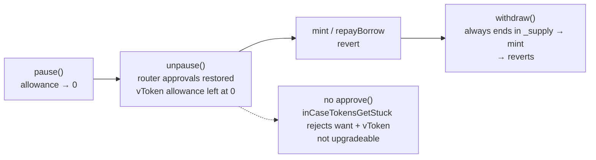
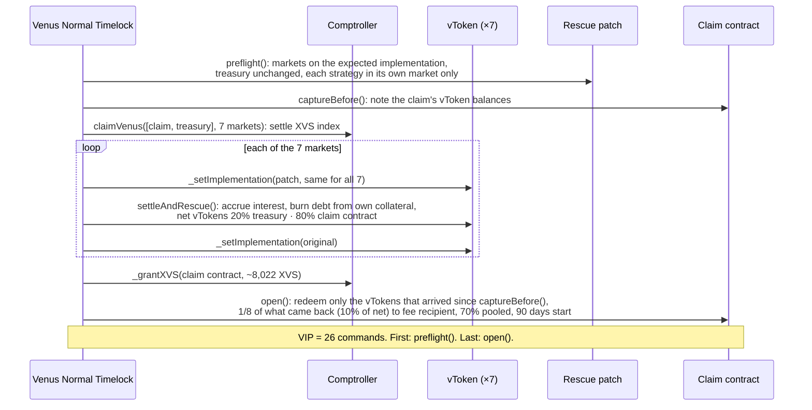
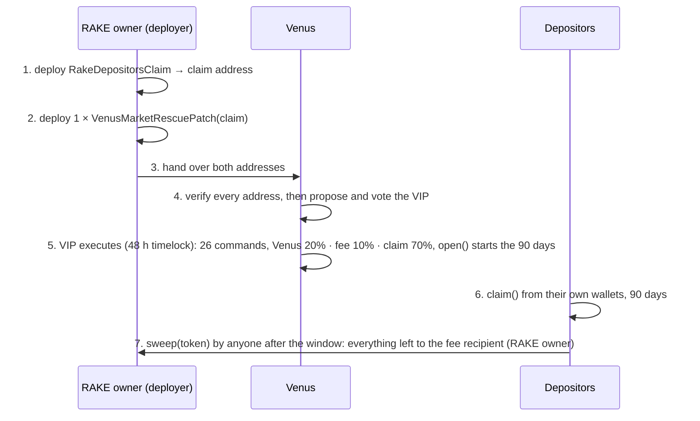
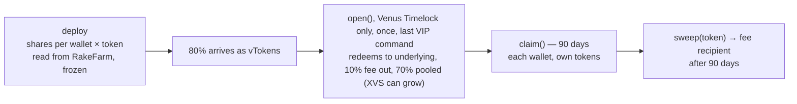
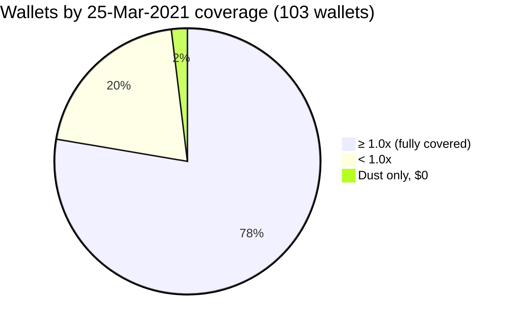
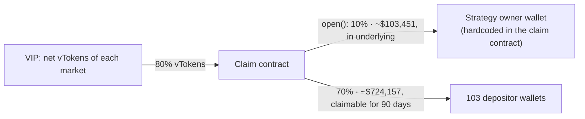

# Technical appendix

Code: `contracts/src/` · Tests: `contracts/test/` · Data: `data/` · Scripts: `contracts/script/`

---

## A1. The bug, and why there is no owner-side fix



- RAKE launched at block 5,195,791 (25 Feb 2021, 20:35 UTC). All seven strategies were paused 1 h 20 min later; the `unpause()` calls at blocks 5,199,574–5,203,969 left the want→vToken allowance at 0.
- The bug in `StratVLEV.unpause()`: `IERC20(wantAddress).safeApprove(vTokenAddress, 0); // should be uint256(-1)`.
- No route out from the owner side:

| Route | Result |
|---|---|
| `withdraw()` at 10/50/72/100% on each of the 7 pools | 28 of 28 revert |
| `pause()` again | sets the allowance to 0 again |
| `inCaseTokensGetStuck` | rejects `want` and `vToken` |
| `rebalance`, `earn`, `deleverageOnce` | revert, or no-op on vBUSD |
| `leverageOnce` | not in the deployed bytecode |
| Self-liquidation (`liquidateBorrow` on vBTC, vETH) | `3 = COMPTROLLER_REJECTION`: the positions are healthy |

The strategies' owner is `0x16c7C45725A977ae6530e8dEE73F6da9aE2e7E07`. The vTokens are proxies whose admin is the Venus Normal Timelock, and that is the only lever left.

**Where part of the BUSD position went.** The position's equity peaked at 315,956 BUSD in mid-2023. After Venus wound down BUSD, the market stopped paying supply interest while the frozen borrow kept accruing, which cost about 57,000 BUSD. On 27 October 2023 the position was liquidated through Venus's Liquidator in one transaction (`0x40c6147f55b66c4b11a4780723e0e92756000cce0634c342f2366fa1f0370273`): it repaid the 521,222 BUSD borrow and seized 573,344 BUSD of collateral, a 52,123 BUSD penalty. 206,755 BUSD remains, with no debt, and is part of this recovery.

---

## A2. The rescue: one VIP transaction



The debt math: retiring borrow `d` while burning `d / ER` vTokens leaves the exchange rate unchanged.

```
ER = (cash + borrows − reserves) / supply
(N − d) / (TS − d/ER) = N / TS = ER
```

- `VenusMarketRescuePatch`: one patch for all 7 markets, which share implementation `0xCDfea50f7CECCB24Fe804657DB8E6c93b689941e`. Only the claim contract is passed at deploy (constructor `(claim)`); that original implementation, the Venus treasury `0xF322942f644A996A617BD29c16bd7d231d9F35E9`, the 20% / 80% split and the market → strategy table are constants. The patch has no fee recipient. Under the market's delegatecall, the patch finds the market's strategy from a fixed table of the 7 market/strategy pairs (`strategyOf`); any other market reverts. Only the market's live `admin()` can call it. It accrues the market's interest itself first (Venus's own `accrueInterest()`), so it never reads stale state. It reverts if the collateral is below the debt, or if the exchange rate falls.
- The VIP pays everyone inside its own transaction: the patch sends each market's net vTokens 20% to the Venus treasury (they stay vTokens) and 80% to the claim contract. After `preflight()`, the VIP's second command, `claim.captureBefore()`, notes the claim's vToken balances. The last command, `claim.open()` (Venus Timelock only, once), redeems only the vTokens that arrived since then (the one check: the balance grew) through the ordinary Venus redeem, so the claim ends the transaction holding plain tokens; the underlying that redeem returns is what gets distributed: 1/8 of it (10% of the net) goes to the fee recipient (the hardcoded RAKE owner), the rest (70%) becomes the depositors' pool, and the 90 days start. Tokens or vTokens anyone else sends to the claim are never counted; they go to the fee recipient at sweep. If any market was not rescued, the whole VIP reverts and nothing moves. A market whose redeem fails (not enough cash) is pooled and paid out in its vTokens instead, fee included, so it cannot block the other six. A fee transfer that fails stays in the contract as `feeDue` (`withdrawFee`) and blocks nothing.
- **Timelock:** the Normal Timelock (48 h delay) is the admin of all seven vTokens, so the VIP must run through it.
- **Storage writes:** the patch writes the market's storage directly and skips the comptroller hooks (XVS indexes, Prime). That is safe here because the XVS of both holders (claim contract, Venus treasury) is settled first and none of the strategies is a Prime holder.
- **XVS:** the claim contract and the Venus treasury get no XVS for the vTokens they receive, because the VIP's third command (`claimVenus`) sets their reward counter first. Without it, Venus would wrongly credit them XVS for the market's whole reward history (about 3,246 XVS for the claim contract alone).
- **Addresses to verify before the vote:** the 7 strategies, the 7 markets, the rescue patch, the treasury and the claim contract. The RAKE owner deploys both the claim contract and the rescue patch before the vote; Venus deploys nothing.

### Who does what, when



| Step | Who | Needs |
|---|---|---|
| 1. Deploy the claim contract (`Deploy`) | RAKE owner | nothing (all inputs are in the code); the fee recipient (fee and leftovers) is the hardcoded RAKE owner `0x16c7C45725A977ae6530e8dEE73F6da9aE2e7E07`, whoever deploys (no admin powers) |
| 2. Deploy the rescue patch (same `Deploy` script, same run) | RAKE owner | the claim address and the markets' shared `implementation()`, checked to be identical on all 7 |
| 3. Hand over both addresses | RAKE → Venus | `addresses.json` |
| 4. Verify and vote | Venus | `addresses.json`, this repo's tests |
| 5. Execute the 26-command VIP | Venus Normal Timelock | — |
| 6. `claim()` | each depositor | their own wallet |
| 7. `sweep(token)` | anyone, 90 days after `open()` (never before it) | — |

If Venus changes a market's implementation between steps 2 and 5, the VIP's first command, `preflight()`, makes it revert; the patch's `ORIGINAL_IMPL` constant must then be updated, the patch redeployed and the VIP rebuilt.

---

## A3. The claim contract



| Share of total | |
|---|---|
| Venus | 20% |
| Recovery cost | 10% |
| Depositors | 70% |

- **Entitlement:** a wallet's cut of a token = pool × (wallet's farm shares ÷ strategy `sharesTotal`), both fixed at deploy. No amounts are typed in. The recorded shares sum to each pool's total, so the 103-wallet list is complete. One wallet (`0x667cBbEd2E1295EC25381e2b056547eb90FC8F96`) holds a single share of the BUSD pool, worth less than 1 wei, so it receives nothing.
- **Rules:** there is no owner. Only the Venus Normal Timelock (hardcoded) can call `open()`, once, as the VIP's last command; it reverts if no vTokens arrived for a market since `captureBefore()` ("market not rescued"). Pools and the 10% fee come only from what that redeem returned, so dust sent by anyone changes neither. `sweep(token)` (any token, vTokens included) sends everything to the fee recipient (the hardcoded RAKE owner) once 90 days have passed since `open()`, and never before `open()`: the funds and `open()` arrive in the same VIP transaction, so the countdown cannot start without them. Claims are paid only to `msg.sender`, with per-token flags so one token that refuses a transfer blocks only itself. A hard cap stops any token from paying out more than its pool.
- **XVS (granted in the VIP, stays open):** the VIP grants the ~8,022 XVS the strategies earned to the claim contract; more can arrive later, in any number of transfers; Venus takes none of it; the claim sends 10% of each arrival to the fee recipient and the rest is claimable during the window. A wallet's XVS cut = XVS pool × Σ(pool weight × wallet shares ÷ total) ÷ Σ weights. The weights are the XVS each strategy earned (vETH 2,025 · vBUSD 1,887 · vUSDC 1,706 · vBTC 1,423 · vLINK 481 · vUSDT 421 · vDOT 79). The strategies' own XVS entitlement stays on Venus's books (5,455 XVS recorded today, the rest not yet indexed). Nobody can ever take it: `seizeVenus` walks every market ever listed and reverts on the delisted ones, and `claimVenus` can only pay it to the strategies, which cannot move XVS out.
- **Can every wallet claim?** No depositor is a contract. 9 of the 103 carry EIP-7702 delegation code (`0xef0100…`); these are key-held wallets that call `claim()` directly.
- **Entitlement table:** `data/depositor_share_of_each_frozen_pool.csv` gives each wallet's % of each pool, read from RakeFarm `userInfo` ÷ `sharesTotal`. The 103 wallets sum to 100.000000% of every pool. The constructor reads only the 146 wallet/pool pairs that hold shares and reverts unless they add up to each pool's `sharesTotal`. Amounts = % × the pool's depositor share on the day the funds arrive.
- **Claim site:** https://rakeclaim.com

---

## A4. The 2021 compensation data



| Basis | Wallets ≥ 1.0x | Aggregate shortfall |
|---|---:|---:|
| First 7 days | 56 of 103 | $15,592 |
| To 25 March 2021 | 80 of 103 | $4,130 |

- Coverage per wallet = USD value of the RAKE that wallet earned from the frozen pools ÷ its frozen equity. Only rewards from the 7 frozen pools are counted.
- Frozen equity is valued at 24 July 2026 prices (BSC block 114,966,322, total $972,308).
- Dust wallets: 2 (`0x037ea234207D23A14d1c155fd58B57655A338a17`, `0x667cBbEd2E1295EC25381e2b056547eb90FC8F96`) hold 1 farm share each, worth $0, so they have no coverage ratio.
- Wallets that never sold RAKE: 6, with a combined frozen equity of $68 (including the 2 dust wallets).
- Founder wallet `0x16c7C45725A977ae6530e8dEE73F6da9aE2e7E07`, 9,702.43 RAKE minted:

| Where | RAKE | % |
|---|---|---|
| Still in the wallet | 8,933.66 | 92.08% |
| Burned (sent to `0x000000000000000000000000000000000000dEaD`) | 607.48 | 6.26% |
| Sold for BNB: 10 sales, 8 Mar – 25 Apr 2021, 24.68 BNB (~$9,242) | 87.10 | 0.90% |
| Sent to 3 wallets | 55.00 | 0.57% |
| Sent to the RAKE token contract (unrecoverable) | 20.00 | 0.21% |
| Liquidity + 1 small transfer | 0.07 | 0.00% |

- Source: `data/depositor_2021_rake_compensation.csv` (one row per wallet; columns explained in `data/README.md`).

---

## A5. Tests and reproduction

```
cd contracts
forge install foundry-rs/forge-std --no-git
forge test --match-contract '^RakeDepositorsClaimTest$'                   # unit, no RPC
FORK_BLOCK=<recent block> forge test -j 2                                  # everything, on a BSC fork; BSC_RPC_URL defaults to
                                                                          # https://bsc-rpc.publicnode.com, -j 2 because public RPCs drop requests

forge script script/simulation/RescueAmounts.s.sol --fork-url $BSC_RPC_URL --fork-block-number 133013326
                                     # the proposal's figures: ~$1,034,510 at Venus oracle prices
export BSC_MEV_RPC_URL=https://bscrpc.pancakeswap.finance   # MEV-protected RPC for every --broadcast
forge script script/live/Deploy.s.sol --rpc-url $BSC_MEV_RPC_URL --broadcast
                                     # RAKE: deploy the claim contract and the one rescue patch; both recorded in addresses.json
forge script script/live/VenusRescueProposal.s.sol --fork-url $BSC_RPC_URL
                                     # the proposal: targets, values, signatures, calldatas
forge script script/simulation/SimulateVIP.s.sol --fork-url $BSC_RPC_URL
                                     # the whole VIP on a fork, no key: every command, where the funds go
```

| Script | What it does | Its test |
|---|---|---|
| `RescueAmounts` | read-only: each position's net value (tokens, USD at Venus oracle prices) and the 20/10/70 split | n/a (it only reads) |
| `Deploy` | RAKE owner: deploys the claim contract (fee recipient = the hardcoded RAKE owner, gets fee and leftovers; only the Venus Timelock opens it, inside the VIP), then the one `VenusMarketRescuePatch` bound to it and the markets' shared implementation | `DeployTest` |
| `SimulateVIP` | a random wallet deploys both contracts on a fork, sends all 26 commands from the Timelock (`open()` included), prints gas per step and each token's 20/10/70 amounts, saves the `propose()` arrays to `out/vip-proposal.json` | `VenusRescueProposalTest` |
| `VenusRescueProposal` | builds the 26 commands (`preflight()` first, `open()` last) and prints them in `GovernorBravo.propose()` form | `VenusRescueProposalTest` sends those exact bytes from the Timelock |

| Suite | What it proves | Result |
|---|---|---|
| `RakeDepositorsClaimTest` | pro-rata split, 10% fee taken in underlying at `open()`, 90-day window, only the Venus Timelock opens and only once (1 wei cannot open early), only a RAKE market can record a rescue, dust (underlying or vTokens) changes neither pool nor fee, `open()` reverts if a market was not rescued, sweep only 90 days after `open()` (never before it), XVS 10% fee, weighting and late XVS, no double claim, claimable = 0 after the window | 23 / 23 |
| `VenusRescueProposalTest` | the proposal's exact 26 commands on a BSC fork (the same list the script prints): 20/10/70 split per market, `open()` last in the VIP, dust sent before the VIP not counted, admin-only patch, XVS settle for both holders = 0 (and the windfall without it), XVS grant (10% fee), other suppliers unchanged on all 7 markets; full chain VIP → `open()` → all 103 wallets claim exactly their share → pools empty to dust → sweep; only the Timelock opens, once; a late VIP starts the window when it runs; no sweep before the VIP; `preflight()` stops the VIP if an implementation, the treasury or a strategy's markets changed; a failed redeem pays out in vTokens; a failed fee transfer blocks nothing | 21 / 21 |
| `PostRescueRakeFarmSafetyTest` | after the rescue: nobody can deposit, inflate farm shares or withdraw twice; the VIP opens and depositors claim | 1 / 1 |
| `DeployTest` | the hardcoded RAKE owner is fee recipient (fee and leftovers), only the Timelock opens; tokens in market order; all 103 depositors snapshotted; the one patch is bound to the claim contract, the treasury and the shared implementation, and knows the 7 strategies; refuses to deploy if a market's implementation changed | 4 / 4 |
| `VenusMarketRescuePatchTest` | debt settled from the strategies' own collateral on all 7 markets (20/80 vTokens, exchange rate never falls, one-wei drift bound), admin-only, one-shot, accrual required, unknown market reverts, no outside capital | 6 / 6 |

Fork runs were made at BSC block 133,012,831 (55 / 55 pass).

---

## A6. Recovery cost, 10%



| Work the 10% covers | Where to check it |
|---|---|
| Expert hired to investigate the bug and confirm there is no owner-side fix | A1 |
| On-chain reconstruction of every depositor's position and 2021 compensation | A4, `data/` |
| Rescue patch and claim contract | A2, A3, `contracts/src/` |
| Fork tests, deploy scripts and the VIP builder | A5, `contracts/script/` |
| In-house audit of the contracts | `contracts/` |
| Claim site | https://rakeclaim.com |
| This proposal | this repo |

- Paid in underlying inside the VIP by `open()` (10% of each market's net), and 10% of the XVS granted. It is a fixed share and does not depend on how many depositors claim.
- Paid to the strategy owner `0x16c7C45725A977ae6530e8dEE73F6da9aE2e7E07`, hardcoded in the claim contract, whoever deploys it.
- All of this work was paid for up front by the owner. Nobody else advanced any capital.
