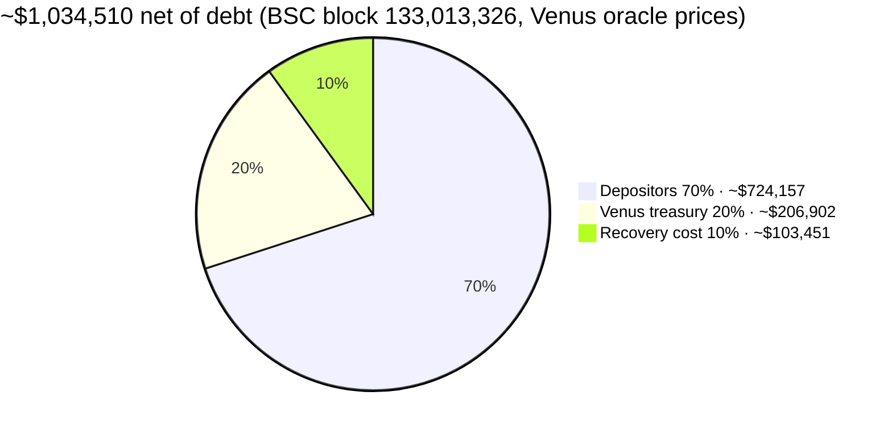
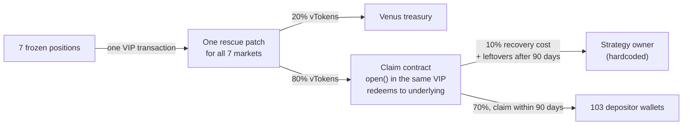

# Returning RAKE's frozen Venus funds to depositors

**Proposer:** RAKE founder and owner of the affected strategy contracts  
**Contact:** Discord 5ubse7en · f0r3x_shark@protonmail.com

## Summary

Since February 2021, about $1,035,000 of depositor funds has been frozen in seven Venus markets by a bug in RAKE's own strategy contracts. Only a Venus governance action can release it.

We ask Venus to approve one atomic transaction that settles each frozen position's debt from its own collateral and splits what is left: 20% to Venus, 10% to RAKE as recovery cost *(Appendix [A6](APPENDIX.md#a6-recovery-cost-10))*, 70% to a claim contract. Each of the 103 depositors withdraws their share of that 70% from their own wallet. Nobody holds the funds in between.

The Venus transaction itself opens a 90-day claim window. Unclaimed funds then go to the strategies' owner, whose address is hardcoded in the claim contract.

## 1. What happened

RAKE, an auto-compounding farm on BNB Chain, launched on 25 February 2021 with single-asset vaults that supplied to Venus: BUSD, BTC, ETH, LINK, USDT, USDC and DOT. About 80 minutes after launch we paused deposits as a precaution. The strategy code, an outdated copy of AutoFarm's leveraged Venus strategy, unpauses without restoring the vault's permission to use its Venus market, so none of the seven could supply, repay or withdraw again.

Our owner keys cannot fix it. No function restores the permission, the contracts cannot be upgraded, and the emergency function excludes these exact tokens. We tested every route, including liquidating our own positions. Only Venus, which controls the markets, can act. *(Appendix [A1](APPENDIX.md#a1-the-bug-and-why-there-is-no-owner-side-fix).)*

## 2. What we did in 2021

We compensated depositors at our own expense. The frozen vaults kept their full RAKE rewards, even though they no longer earned for the platform, and the founder stopped selling their allocation, their only pay. That allocation was at least as large as what the frozen pools earned, so every RAKE the founder did not sell left depositors the liquidity and price performance they needed to sell theirs. In effect, the founder's pay went to depositors. On-chain today:

- **98.5% of the founder's RAKE was never sold or given away:** 92.1% is still in the original wallet and 6.5% was burned or locked in the token contract. Only 0.9% was ever sold, for about $9,200.
- **80 of 103 affected wallets** had received RAKE worth at least their whole frozen position by 25 March 2021, counting only the frozen pools. 21 were short about $4,100 in total, and 2 hold only dust ($0).
- **97 of 103 wallets sold their RAKE.** The six that never sold hold under $70 frozen.

Coverage uses 24 July 2026 prices (block 114,966,322). *(Appendix [A4](APPENDIX.md#a4-the-2021-compensation-data).)*

## 3. Why now

We first raised this with Venus in 2021, but Venus had a full plate at the time due to unrelated events, so we focused on compensating affected users as described above. Since then, we have hired an expert to confirm we have exhausted all options in our power to recover the funds, and we are confident it will require action from Venus. We have also completed development of the scripts, contracts and frontend that will be required to do a proper recovery. This proposal follows significant communication with the Venus team.

- **The debt keeps growing.** It accrues interest nobody can repay.
- **Venus's own risk actions erode the positions.** When DOT was deprecated as collateral, the DOT position was liquidated sixteen times in under a minute. LINK is exposed to the same.
- **Unmanageable positions are a liability** on Venus's books.

## 4. The proposal

**One transaction.** For each market, the VIP swaps in the same narrowly scoped rescue patch (the seven markets share one implementation). The patch settles the position's debt from its own collateral and splits the net vTokens: 20% to the Venus treasury, 80% to the claim contract. The VIP then restores the original implementation, and its last command, `claim.open()`, redeems only the vTokens that arrived during the VIP (an earlier command notes the starting balances) through the ordinary Venus redeem, pays 1/8 of what came back (10% of the net) to the strategies' owner in underlying, pools the other 70% for depositors and starts the 90-day window. Anything else sent to the claim is never counted. The exchange rate and cash do not change, so other suppliers lose nothing. If any rescue step fails, everything reverts and nothing moves; a market that cannot redeem pays depositors in its vTokens instead. No capital is advanced and nobody has to forward funds. *(Appendix [A2](APPENDIX.md#a2-the-rescue-one-vip-transaction) and [A5](APPENDIX.md#a5-tests-and-reproduction).)*

**Who deploys what.** The RAKE owner deploys the claim contract and the one rescue patch bound to it, before the vote; Venus deploys nothing. The fee and leftovers go to the RAKE owner (`0x16c7C45725A977ae6530e8dEE73F6da9aE2e7E07`), hardcoded in the claim contract, whoever deploys it. Every address is in `addresses.json`.

**How depositors claim.** The claim contract records each wallet's farm shares at deployment, read from RAKE's farm. Nobody types in an amount. Each depositor claims on https://rakeclaim.com from the wallet they deposited with and receives their share of every token the claim holds: BUSD, BTC, ETH, LINK, USDT, USDC, DOT and XVS. Every wallet's share is published in [depositor_share_of_each_frozen_pool.csv](data/depositor_share_of_each_frozen_pool.csv). *(Appendix [A3](APPENDIX.md#a3-the-claim-contract).)*

**Fees.** Venus 20%, for the governance action and the review. Recovery cost 10%, paid in underlying inside the Venus transaction *(Appendix [A6](APPENDIX.md#a6-recovery-cost-10))*. Depositors 70%. Neither fee depends on how many depositors claim.

**Unclaimed funds.** After the 90 days, what is left goes to the strategies' owner. Since these events happened in 2021, a significant portion of the affected wallets are now inactive, lost or compromised. Sending tokens to them automatically would only result in permanent loss. The owner is a party to this recovery, since the positions sit in the owner's contracts. The owner also bore the cost of the 2021 compensation and paid for the work behind this recovery. The Venus Timelock opens the window as the last command of the Venus transaction; `sweep()` lets anyone send everything to the owner 90 days after `open()`. The 90 days start only when that transaction is confirmed: before it, nothing can be swept.

**Notifying depositors.** When the window opens, each of the 103 wallets gets an on-chain message: a zero-value transaction carrying the claim link and the deadline. The vote and the claim window are also announced on the Venus governance forum, the Forex Shark Calls Telegram channel (@forexsharkcalls) that announced RAKE, and the owner's X account (https://x.com/F0r3x_Shark); the dates are on https://rakeclaim.com.

## 5. What Venus is being asked to accept

A temporary change to seven market contracts, inside one transaction, that:

- touches only the seven hard-coded RAKE positions;
- creates no bad debt and leaves other suppliers' balances, the exchange rate and cash unchanged;
- sends every asset recovered for depositors, including the XVS the strategies earned, to the claim contract *(Appendix [A2](APPENDIX.md#a2-the-rescue-one-vip-transaction))*;
- checks first that every market still runs the expected implementation and the treasury is unchanged, restores the original implementations, and reverts completely if any rescue step fails.

In return Venus gets about $207,000, seven unmanageable positions closed, and an in-house-audited, fully tested recovery paid for by us.

## 6. Precedent

We would support a standard for any future request:

- the bug is in the project's own code, not Venus's;
- no owner-side fix exists;
- no bad debt and no change to other users;
- a narrow, single-transaction change;
- funds go to users through a contract, not the project team;
- tests anyone can run.

This proposal meets all six. In a past Venus recovery for AutoFarm, which had the same bug, funds went to the owner on a promise that was never kept; here they go to depositors first, through a contract we do not control.

## 7. Disclosures

- **Figures will change.** Dollar values move with prices and will be refreshed on filing day; `contracts/script/simulation/RescueAmounts.s.sol` reproduces them at any block. `contracts/script/simulation/SimulateVIP.s.sol` runs the whole VIP on a BSC fork and prints where every token goes.
- **Our data is our own.** The per-wallet compensation figures are our reconstruction from public chain data. Independent checks are welcome.
- **Part of the BUSD position is gone.** Interest after Venus wound down BUSD, and a liquidation on 27 October 2023, took part of it. 206,755 BUSD remains, with no debt. *(Details in Appendix [A1](APPENDIX.md#a1-the-bug-and-why-there-is-no-owner-side-fix).)*

## Technical appendix

The full technical appendix is in [APPENDIX.md](APPENDIX.md):

- **[A1](APPENDIX.md#a1-the-bug-and-why-there-is-no-owner-side-fix):** the bug, and why there is no owner-side fix
- **[A2](APPENDIX.md#a2-the-rescue-one-vip-transaction):** the rescue, one VIP transaction
- **[A3](APPENDIX.md#a3-the-claim-contract):** the claim contract and every wallet's share
- **[A4](APPENDIX.md#a4-the-2021-compensation-data):** the 2021 compensation data
- **[A5](APPENDIX.md#a5-tests-and-reproduction):** tests and reproduction
- **[A6](APPENDIX.md#a6-recovery-cost-10):** the 10% recovery cost
