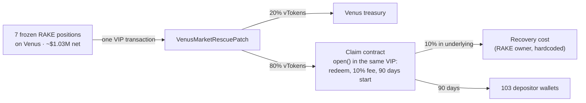

# RAKE × Venus: returning frozen funds to depositors



| File | What it is |
|---|---|
| [PROPOSAL.md](PROPOSAL.md) | The proposal to Venus |
| [APPENDIX.md](APPENDIX.md) | Technical appendix A1–A6 |
| [addresses.json](addresses.json) | Every address the VIP touches |
| [data/depositor_share_of_each_frozen_pool.csv](data/depositor_share_of_each_frozen_pool.csv) | What each of the 103 wallets can claim: its % of each frozen pool |
| [data/depositor_2021_rake_compensation.csv](data/depositor_2021_rake_compensation.csv) | What each wallet already received in RAKE in 2021, against its frozen value |
| [data/README.md](data/README.md) | What every column in those two files means |
| `contracts/src/` | The two contracts: `VenusMarketRescuePatch` (one patch for all 7 markets) and `RakeDepositorsClaim` |
| `contracts/script/simulation/RescueAmounts.s.sol` | Read-only: each position's net value and the 20/10/70 split, live from BSC |
| `contracts/script/live/Deploy.s.sol` | Steps 1-2, RAKE: deploys the claim contract and the one rescue patch bound to it, records both in `addresses.json` |
| `contracts/script/live/VenusRescueProposal.s.sol` | Step 4, Venus: prints the proposal Venus submits: targets, values, signatures, calldatas |
| `contracts/script/simulation/SimulateVIP.s.sol` | The whole VIP on a BSC fork, no key: deploys, a random wallet deploys, the Timelock runs all 26 commands (`open()` last), logs each one and checks where the funds go |
| `contracts/src/libraries/` | Shared by scripts and tests: the addresses, the deployment, the proposal's command list |
| `contracts/test/` | One test file per contract and per deploy/proposal script, same name, plus `PostRescueRakeFarmSafety` |
| Claim site | https://rakeclaim.com |

```
cd contracts && forge install foundry-rs/forge-std --no-git
export BSC_RPC_URL=<BSC RPC>   # optional for tests: they default to https://bsc-rpc.publicnode.com
export BSC_MEV_RPC_URL=https://bscrpc.pancakeswap.finance   # MEV-protected; every --broadcast goes through it
forge script script/simulation/RescueAmounts.s.sol --fork-url $BSC_RPC_URL           # what moves, and to whom
forge script script/live/Deploy.s.sol --fork-url $BSC_RPC_URL                 # RAKE deploys both contracts, dry run (needs $PRIVATE_KEY)
forge script script/live/VenusRescueProposal.s.sol --fork-url $BSC_RPC_URL     # the proposal's commands
forge script script/simulation/SimulateVIP.s.sol --fork-url $BSC_RPC_URL             # the whole VIP on a fork, results printed
forge test --match-contract '^RakeDepositorsClaimTest$'                   # no RPC
forge test -j 2                                                           # all, on a BSC fork (public RPCs drop requests with more threads)
forge test --mc VenusRescueProposalTest -vv                              # one suite; fork tests default to https://bsc-rpc.publicnode.com
```
